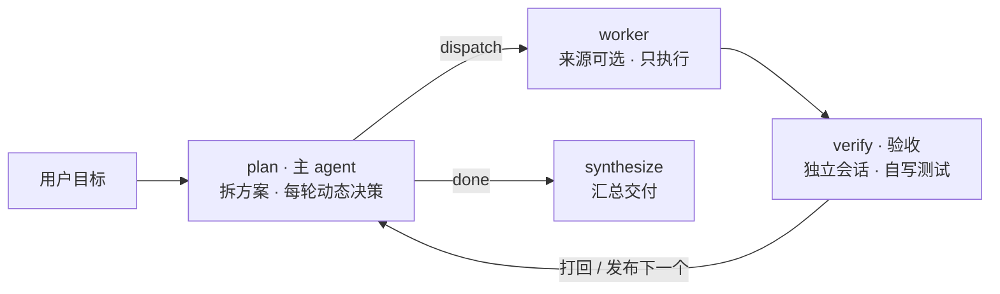

# Lodestar — LangGraph 三角色协作：主 agent（动态 plan）+ worker + 验收 agent

主 agent 是唯一在循环里的思考节点 `plan`：先拆「任务方案」，之后每轮读完产出和验收结果，动态修订方案再发布下一轮目标。worker 动手改文件；验收 agent 是另一个独立会话，自己写 test 脚本并执行来判定达标。

三个节点**各自选一个模型来源**：可以是 OpenAI 兼容的 HTTP 接口，也可以是本机的 CLI（codebuddy / codex / trae …）。想混搭就混搭 —— 主 agent 走 API、worker 走 codebuddy、验收换另一个 CLI，改配置即可，不动代码。



方案不是写死的 —— plan 每轮拿到「目标 + 已完成记录 + 当前验收结果 + 剩余方案」，可以补任务、改验收标准、删任务或安排补救。

## 快速开始

| 依赖 | 要求 | 用途 |
| --- | --- | --- |
| [uv](https://docs.astral.sh/uv/) | 最新版 | 环境、依赖、跑命令 |
| Python | 3.10+ | 后端（本机没有时 uv 自动下载） |
| 模型来源 | 二选一或都要 | API Key（OpenAI 兼容接口）/ 已登录的 [codebuddy CLI](https://www.codebuddy.cn/docs/cli/installation) |
| [Node.js](https://nodejs.org/) | 20+ | 仅装 CLI 或重建前端时需要 |

```bash
# 1. 装 uv（macOS / Linux）
curl -LsSf https://astral.sh/uv/install.sh | sh
# Windows: powershell -ExecutionPolicy ByPass -c "irm https://astral.sh/uv/install.ps1 | iex"

# 2. 拉代码装依赖
git clone git@github.com:Crazyboy233/lodestar-agent.git && cd lodestar-agent
uv sync

# 3. 配 key：在 config.yaml 同目录建 config.local.yaml（已 gitignore）
#    providers:
#      api:
#        api_key: "sk-你的key"
#    或 export DEEPSEEK_API_KEY="sk-你的key"

# 4. 装并登录 CLI（只有用到 cli 来源时才需要）
npm install -g @tencent-ai/codebuddy-code
codebuddy            # 输入 /login，登录后退出

# 5. 起控制台
uv run python -m lodestar_agent --web
```

打开终端打印的地址（默认 `http://127.0.0.1:8788/`，端口占用会自动换）。`codebuddy` 不在 PATH 时，改 `providers.codebuddy.command` 为绝对路径，或把目录加进 PATH。

**可选步骤**

```bash
# 命令行跑一次（默认产出目录 workspace/，页面上可改）
uv run python -m lodestar_agent "在 workspace/fib 里写 fib.py，打印前 10 个斐波那契数（每行一个），确认第一行是 1"

# 只验证 worker 链路，不花 token（跳过主模型与验收）
uv run python -m lodestar_agent --dry-run "在 workspace 里创建 hello.py"

# 离线自检：图结构、打回重试、轮次上限、拆解重试、checkpoint 续跑、来源装配，
# 不依赖模型和登录态
uv run python tests/offline_check.py

# 重建前端（改了 frontend/ 才需要；static/ 已提交，正常使用可跳过）
cd frontend && npm ci && npm run build && cd ..
```

`tests/offline_check.py` 在 Windows 上会跳过少数依赖 `/bin/sh` 的进程组用例，进程树回收由 `windows_tree_kill` 用例覆盖。前端构建产物写回 `lodestar_agent/static/`，刷新浏览器即可，不用重启 Python。

### checkpoint 与续跑

每次运行的 state 落在 `checkpoints.sqlite`（已 gitignore），一次运行对应一个 `thread_id`：

```bash
uv run python -m lodestar_agent --thread-id fix-fib "在 workspace/fib 里写 fib.py …"
uv run python -m lodestar_agent --thread-id fix-fib --resume   # 中断/失败后从断点继续
```

- 只重跑「上次没走完的节点」，已定稿的任务不重做；worker 跑完只差验收的直接补验收。
- 执行失败终止的线程，`--resume` 会把该任务重试计数归零，否则一进 plan 就又撞上限。
- 同一 `thread_id` 不加 `--resume` 会报冲突，避免新 state 脏覆盖旧 checkpoint。

## 模型来源（核心）

配置分成两层，刻意分开：

```yaml
providers:          # 「模型从哪来」：一条通道怎么调用
  api:
    kind: api       #   OpenAI 兼容 HTTP 接口
    base_url: "https://api.deepseek.com"
  codebuddy:
    kind: cli       #   本机命令行 agent
    command: "codebuddy"

nodes:              # 「谁用哪个模型」：三个节点各选一个来源
  main:   { source: "api",       model: "deepseek-flash" }
  worker: { source: "codebuddy", model: "" }
  verifier: { source: "codebuddy", model: "" }
```

`source` 就是 `providers` 里的 key，三个节点彼此独立。每个来源声明自己支持哪几类能力：

| 能力 | 谁用 | API 来源 | CLI 来源 |
| --- | --- | --- | --- |
| `chat` 纯文本 | plan / 动态决策 / 汇总 | 直接调接口（流式、可中途断开） | 用 CLI 跑一次拿文本（不带工具权限） |
| `agent` 会干活 | worker / 验收 | 内置工具循环：read / write / list / run 命令，沙箱在产出目录内 | CLI 自己的工具权限（`allowed_tools`） |

所以四种组合都成立：API 主 agent + CLI worker（默认）、CLI 主 agent + API worker、全 CLI、全 API。

**接一个新 CLI 不用改代码**，加一段配置即可（`dialect: template` 由你描述参数形状）：

```yaml
providers:
  codex:
    kind: cli
    command: "codex"
    dialect: "template"
    args:                        # 每项是字符串，或一组参数（组内占位符为空 → 整组跳过）
      - ["exec", "{prompt}"]
      - ["--model", "{model}"]
    output: "text"               # text / json（json 取最后一个 JSON 的 result 字段）
    resume_args: ["resume", "{session}"]
    session_regex: "session id: ([A-Za-z0-9-]+)"

nodes:
  worker: { source: "codex", model: "" }
```

可用占位符：`{prompt}` `{model}` `{tools}` `{max_turns}` `{add_dirs}` `{session}`。`{add_dirs}` 会展开成多个参数。输出格式特殊到模板描述不了时（比如自带事件流协议），在 `lodestar_agent/providers/cli/dialect.py` 里加一个 `Dialect` 子类并注册，别的文件不用动。

## 控制台

`--web` 只起页面、不带任务也支持；`--web "任务…"` 则起服务并立即开跑。左侧导航三块：

- **新任务**：回到任务输入框，同一进程可连续跑多个任务。
- **设置**：弹窗改配置（见「在页面里改配置」）。
- **任务历史**：按产出目录分组（一个目录 = 一个项目），点开可见任务清单与最终答复，可「继续这个会话」（可顺手写引导、单独换任一节点的来源与模型）或「在此目录新建任务」。

输入卡上可指定**产出目录**（点路径弹系统文件夹选择器，不选则用 `nodes.worker.workdir`），以及**三个节点各自的来源与模型**（默认值来自配置，会记住上次的选择）。开跑后底部输入卡切成「引导」，可选投给**主 agent** 还是 **worker**；右侧「任务」面板列出每条拆解及其状态、轮次、耗时。

事件流每行四列：时间 · 节点（PLAN / WORK / VERIFY / FINAL）· 内容类别 · 正文。类别与节点正交：`派发` 是模型真正收到的 prompt，`任务` 是摘出来的人读版任务与验收标准，`输出` 是节点产出，`旁白` 是流程说明，`引导` 是投递进来的指令。超过 10 行会截断并给「展开全文」。

一次只跑一个：运行中「新任务」禁用，输入只发引导。每次开新任务会 `reset` 控制面（停止标志、引导信箱、事件流清空）。

「引导与退出」的边界语义：

| 操作 | 后台 | 生效时机 |
| --- | --- | --- |
| 开始任务 | 新线程跑一次 `run_session` | 立即（控制面先 reset） |
| 发引导 | 入队到对应信箱 | 下一次决策 / 下一次 worker 调用拼进 prompt，**投一次生效一次**，不打断当前轮 |
| 续跑前写引导 | 随 `run` 送 `seed_notes`，`reset()` 后立刻补投 | 续跑第一个节点边界 |
| 续跑换来源/模型 | `main_source` / `worker_model` 等随 `run` 传；不传 = 沿用配置，空串 = 该来源的默认模型 | 本次运行立即生效 |
| 边界退出 | 置停止标志 + 等待上限 | **当前这轮模型回复跑完再收工**（退出码 130），超 `ui.drain_timeout_seconds` 才强杀 |

边界退出不是「中断」：跑完的 worker 不再进验收、跑完的验收不再进规划，做出的是完整产出而非半成品。**停掉模型和停掉脚本是两件事**，这里做前者 —— CLI 子进程按进程树回收（POSIX 进程组 SIGTERM→SIGKILL，Windows `taskkill /T /F`），HTTP 连接才会断，不再烧 token；纯文本角色走流式调用，到点直接关生成器（CLI 当纯文本模型时只能杀进程，那一轮产出会丢，语义相同）。退出后按真实完成度记 `[PASS]` / `[FAIL]` / `[SKIP] 已执行，未验收`。

为什么不直接给跑着的 worker 发消息：`codebuddy -p` 是次性子进程，stdin 已关闭，执行期间没有注入通道，所以做成「排队 + 节点边界消费」。

### 在页面里改配置

「设置」弹窗分「主 agent / worker / 验收 / 每个来源 / 控制台」几组，`config.yaml` 里除 `ui.host / port / web` 外都能改：

| 分组 | 可改 |
| --- | --- |
| 三个节点 | `source`（来源）、`model`，以及各自的执行参数（工具、超时、轮次、重试、目录、env） |
| api 来源 | `base_url`、`api_key`、`temperature`、`timeout_seconds` |
| cli 来源 | `command`、`dialect`、`timeout_seconds`、`chat_tools`、`chat_cwd`、`env` |
| 控制台 | `drain_timeout_seconds`、各来源的候选模型 |

写入 `config.local.yaml`（覆盖层，不动 `config.yaml`）；api_key 只回显掩码，留空 = 不修改；**下次开始任务生效**，运行中保存返回 409；字段有范围校验，任一不合法整次失败，不做「一半生效」。

## 三个角色

| 角色 | 默认跑在哪 | 职责 | 权限 |
| --- | --- | --- | --- |
| 主 agent | DeepSeek API（你的 key） | 拆任务、写验收标准、每轮读进度并动态决策、汇总 | 不碰文件，只调模型 |
| worker | codebuddy CLI 会话 A | 只执行，不判断自己是否完成 | `Read,Write,Edit,Bash` |
| 验收 | codebuddy CLI 会话 B（可换模型） | 自己写 test 脚本并执行，给结论和修改意见 | `Read,Write,Bash`（被测目录只读，脚本写到 `.verify/`） |

三条不能破的约定：

- **「完成」由验收方判定**，不采信 worker 自述。
- **主 agent 每轮都知道进展**：拿到目标、已完成记录、当前验收结果、剩余方案后再决策。
- **验收标准必须可执行**：带「浏览器 / 控制台报错 / 响应式 / 美观」这类词的会被丢掉，交回验收 agent 自行设计静态检查。

验收建议选一个和 worker 不同的模型（甚至不同的来源）—— 否则两边判定是同一个模型在自说自话。

## 闸门（防死循环 / 防跑飞）

| 闸门 | 配置 | 命中后 |
| --- | --- | --- |
| 单条子任务往复次数 | `nodes.verifier.max_rounds`（默认 3） | 判失败，记入汇总，继续下一条 |
| 单次调用内部轮数 | `nodes.worker.max_turns`（默认 0 = CLI 不传 / API 取默认 30） | CLI 自己停下并报 `Max turns exceeded`；API 报「工具循环未收敛」 |
| 单次调用墙钟 | `nodes.worker/verifier.timeout_seconds`（worker 默认 600） | 终止整棵进程树 / 中止工具循环；已产出内容保留并交验收，重试用 `--resume` 接同一会话 |
| 图节点总步数 | `recursion_limit=120` | 兜底防图打转 |
| 主 agent 请求失败 | `nodes.main.max_retries`（默认 3） | 重试耗尽 → 终止，报失败节点+原因 |
| 拆解解析失败 | `nodes.main.plan_retries`（默认 2） | 带纠正提示重试，用尽退化为单任务 |
| worker / 验收失败 | `nodes.worker/verifier.max_retries`（各默认 2） | 重试耗尽 → 终止，报失败节点+原因 |

## 配置说明（config.yaml）

| 字段 | 说明 |
| --- | --- |
| `providers.<名>.kind` | `api`（HTTP）/ `cli`（本机命令）；不写就按字段猜 |
| `providers.api.base_url` / `api_key` / `temperature` / `timeout_seconds` | 接口地址与凭据。key 建议放 `config.local.yaml`，留空读 `DEEPSEEK_API_KEY` |
| `providers.<cli>.command` / `dialect` | 可执行名或绝对路径；方言决定参数形状与输出解析 |
| `providers.<cli>.args` / `resume_args` / `output` / `session_regex` | 模板方言（非 codebuddy 的 CLI）用它们描述调用方式 |
| `providers.<cli>.chat_tools` / `chat_cwd` | 这个 CLI 当纯文本模型用时传的工具参数 / 工作目录 |
| `nodes.main.source` / `model` / `temperature` | 主 agent 用哪个来源的哪个模型 |
| `nodes.main.max_retries` / `plan_retries` | 请求重试次数；拆解解析失败重试次数（用尽退化为单任务） |
| `nodes.worker.source` / `model` | worker 的来源与模型（`model` 留空 = 该来源默认） |
| `nodes.worker.workdir` | 默认产出目录 / 两个执行节点的 cwd，每次任务可在页面另选 |
| `nodes.worker.allowed_tools` / `verifier.allowed_tools` | 前者 `Read,Write,Edit,Bash`；后者 `Read,Write,Bash`（写 test 脚本需要 Write）。API 来源按同一份清单映射成内置工具 |
| `nodes.verifier.scratch_dir` | 测试脚本目录（相对 `workdir`），默认 `.verify` |
| `nodes.worker.max_turns` | CLI 透传 `--max-turns`；**0 = 不传**，用 CLI 默认。API 来源则是工具循环轮数（0 取默认 30） |
| `nodes.verifier.max_rounds` | 同一条子任务最多「执行 → 验收」几轮 |
| `nodes.*.max_retries` | 各自请求失败重试次数，超限终止流程 |
| `nodes.worker.add_dirs` | 额外授权目录（默认只能动 workdir） |
| `nodes.*.env` | 额外环境变量，只作用于该节点（如 `CODEBUDDY_AUTH_TOKEN`） |
| `ui.web` | true = 不写 `--web` 也默认开控制台 |
| `ui.host` / `ui.port` | 控制台监听地址与端口（默认 127.0.0.1:8788，占用回退随机端口） |
| `ui.drain_timeout_seconds` | 边界退出后最多再等多久（默认 120s） |
| `ui.models.<来源>` | 页面下拉候选，按来源分组；不写用该来源默认候选 |

旧格式（`main_agent` / `worker` / `verifier` 三段）在读取时自动迁移成 `providers` + `nodes`，老配置文件不用手改。

## 文件结构

| 文件 | 作用 |
| --- | --- |
| `config.yaml` | 唯一配置入口：来源 / 三个节点 / 控制台 |
| `lodestar_agent/config.py` | 读配置（支持 `config.local.yaml` 覆盖、旧格式迁移），页面可编辑字段的白名单与校验 |
| `lodestar_agent/providers/base.py` | 契约：`ChatBackend`（纯文本）/ `AgentRuntime`（会干活）/ `RunResult` |
| `lodestar_agent/providers/registry.py` | 来源注册表：按名字造对象、能力校验、启动自检 |
| `lodestar_agent/providers/api.py` / `api_agent.py` / `local_tools.py` | HTTP 来源：纯文本调用 + 工具循环（含沙箱工具） |
| `lodestar_agent/providers/cli/` | CLI 来源：`dialect.py`（参数形状 + 输出解析）、`runner.py`（子进程执行）、`__init__.py`（agent / chat 两种角色） |
| `lodestar_agent/providers/subproc.py` | 子进程公共件：环境白名单、进程树回收、在途进程登记 |
| `lodestar_agent/graph.py` | 图的装配：`State` + 把四个节点连成 `plan → worker → verify → plan → synthesize` |
| `lodestar_agent/nodes.py` | 四个节点的逻辑：`plan`（动态规划）/ `worker` / `verify` / `synth` |
| `lodestar_agent/prompts.py` | 所有 prompt 模板，以及「引导」「进度」两段可插拔片段 |
| `lodestar_agent/records.py` | 任务记录的构造与投影（record → 页面清单 / 历史详情） |
| `lodestar_agent/parsing.py` | 模型输出解析（JSON 抠取）+ 验收标准闸门 + 文本裁剪 |
| `lodestar_agent/llm.py` | 纯文本角色的调用：可中断流式 + 退避重试 + 错误归类 |
| `lodestar_agent/worker.py` | 执行/验收的编排：拼 prompt、跑 agent、把结论整理成 `Verdict` |
| `lodestar_agent/view.py` | 节点产出 → 展示行（终端 / 页面 / 日志三个出口） |
| `lodestar_agent/logfmt.py` | 日志格式契约：写入端与「回看历史」解析端共用同一份常量 |
| `lodestar_agent/codes.py` | 退出码 → 会话状态的唯一映射 |
| `lodestar_agent/errors.py` | `AgentFailure`（终止流程）/ `ModelAborted`（主动断开） |
| `lodestar_agent/session.py` | 执行体：`Console`（终端+页面双写）、`run_session`、`Runner`（线程包装） |
| `lodestar_agent/control.py` | 控制面：引导信箱、停止标志、事件总线（SSE 源） |
| `lodestar_agent/history.py` | 运行历史：`history.json` 读写、按产出目录分组、旧 checkpoint 回填 |
| `lodestar_agent/fspick.py` | 系统文件夹选择器：osascript / PowerShell / zenity / kdialog |
| `lodestar_agent/server.py` | FastAPI + uvicorn：JSON 接口、SSE、静态托管（不含页面内容） |
| `lodestar_agent/__main__.py` | 命令行入口：参数、启动自检、模式选择（CLI 同步 / 页面驱动） |
| `frontend/src/` | React + TS 源码。状态集中在 `hooks/`（`useUiMode` 管屏幕与输入区形态、`useRunSession` 管运行态与 SSE、`useHistory` 管历史），`App.tsx` 只做接线 |
| `lodestar_agent/static/` | 前端构建产物（Vite 输出，勿手改） |
| `history.json` | 运行历史（gitignore），按产出目录分组，最多 300 条 |
| `workspace/` | 默认产出目录（gitignore） |
| `checkpoints.sqlite` | 每次运行的 state 快照（gitignore），`--resume` 的数据源 |
| `tests/offline_check.py` | 离线自检 |

## 已知限制

- 子任务**串行**执行；要并行就把 worker 节点改成 `Send` 分发。后一条只能依赖磁盘产出，没有显式上下文传递。
- `-y` 等于全放行；要收紧就删 `Bash` 或缩 `allowed_tools`。
- 验收 agent 的 Bash/Write 理论上仍能碰被测目录，靠「被测目录只读」的约定；要硬隔离就改成副本模式。
- API 来源当 worker 时，工具循环是**简化版**：没有计划/反思/多 agent，轮数与墙钟都有上限；复杂改造仍建议用 CLI 来源。
- CLI 当主 agent（纯文本）时，能否读写文件取决于该 CLI 自己的默认权限（`providers.<cli>.chat_tools` 可显式收紧）。中断只能杀进程，那一轮产出会丢。
- 收尾由「剩余任务为空」决定，不是「全部通过」—— 模型若忘了安排补救，失败项会直接进汇总。
- **引导不能改已在跑的那一轮**：想立刻改只能边界退出再 `--resume`。
- 控制台只监听本机且无鉴权；要暴露到局域网自己加反向代理和访问控制。
- 历史无重命名；删掉 `history.json` 后旧记录会从 checkpoint 回填，但目录归组只能落到默认产出目录。
- 文件夹选择器弹在后端所在机器上；远程访问时会弹在服务器桌面，无图形界面则接口报错（不静默失败）。
