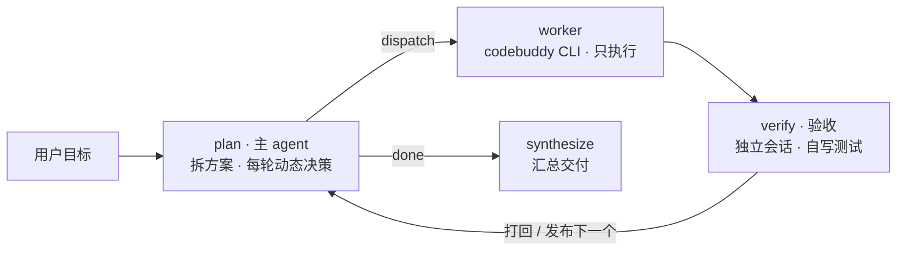

# LangGraph 三角色协作：主 agent（动态 plan）+ worker + 验收 agent

主 agent 是唯一在循环里的思考节点 `plan`：先拆「任务方案」，之后每一轮读完产出和验收结果，动态修订方案再发布下一轮目标。worker 用本机 `codebuddy` 的无头模式动手；验收 agent 是另一个独立的 CLI 会话，自己写 test 脚本并执行来判定达标。



plan 是唯一在循环里的节点：verify 的结果回到 plan，由它决定打回重做还是发布下一个。「任务方案」也不是写死的 —— plan 每轮拿到「目标 + 已完成记录 + 当前验收结果 + 剩余方案」，可以补充新任务、修改验收标准、删掉已不需要的任务，或安排补救。

## 快速开始

```bash
# 1. 装依赖（已生成 uv.lock）
uv sync

# 2. 放 key：config.local.yaml 里写 main_agent.api_key，或 export DEEPSEEK_API_KEY=sk-xxx

# 3. worker / 验收用的 codebuddy CLI 需要登录一次（和 IDE 里的账号不共享）
codebuddy        # 进去输入 /login，登录完退出

# 4. 跑
uv run python -m agent_demo "在 workspace/fib 里写 fib.py，打印前 10 个斐波那契数（每行一个），确认第一行是 1"
```

实测输出（真实跑过的一次，含一次打回）：

```
[主 agent] 拆解任务方案
  1. 创建 workspace/fib/fib.py …   验收: python3 workspace/fib/fib.py | head -1 == 1
  2. 运行并核对首行 …
[worker] 执行  第 1 条 · 第 1 轮      6.6s  → 已创建
[verifier] 验收 → PASS
[主 agent] 动态规划 → 继续下一个（完成 1 条 / 失败 0）
[worker] 执行  第 2 条 · 第 1 轮      18.5s  → 输出首行是 0，不符合要求
[verifier] 验收 → FAIL
[主 agent] 动态规划 → 继续下一个（完成 1 条 / 失败 0）  ← 打回重做
[worker] 执行  第 2 条 · 第 2 轮      19.4s  → a,b = 0,1 改成 1,1
[verifier] 验收 → PASS
[主 agent] 动态规划 → 收尾（完成 2 条 / 失败 0）
[主 agent] 最终答复               两个子任务均通过，产物 workspace/fib/fib.py
```

### 降级路径

```bash
# 只验证 worker 链路（跳过主模型和验收，不花 token）
uv run python -m agent_demo --dry-run "在 workspace 里创建 hello.py"

# 纯离线自检：图结构、打回重试、轮次上限、拆解重试、checkpoint 续跑，都不依赖模型和登录态
uv run python tests/offline_check.py
```

### checkpoint 与续跑

每次运行的 state 落在 `checkpoints.sqlite`（已 gitignore），一次运行对应一个 `thread_id`：

```bash
# 指定 thread id；不给则按时间戳自动生成，日志头部会打印
uv run python -m agent_demo --thread-id fix-fib "在 workspace/fib 里写 fib.py …"

# 中断（Ctrl+C）或执行失败终止后，从断点继续
uv run python -m agent_demo --thread-id fix-fib --resume
```

- 续跑只重跑「上次没走完的节点」，已定稿的任务不会重做。
- **执行失败终止**的线程，`--resume` 会自动把该任务的重试计数归零 —— 否则一进 plan 就又撞上限，等于续不动。
- 同一 `thread_id` 不加 `--resume` 会直接报冲突，避免新 state 脏覆盖旧 checkpoint。

## 三个角色

| 角色 | 跑在哪 | 职责 | 权限 |
| --- | --- | --- | --- |
| 主 agent | DeepSeek API（你的 key） | 拆任务、写验收标准、**每轮读进度并动态决策/改计划**、汇总 | 不碰文件，只调模型 |
| worker | codebuddy CLI 会话 A | 只执行，不判断自己是否完成 | `Read,Write,Edit,Bash` |
| 验收 | codebuddy CLI 会话 B（可换模型） | 自己写 test 脚本并执行，给结论和修改意见 | `Read,Write,Bash`（被测目录只读，脚本写到 `.verify/`） |

三条不能破的约定：

- **「完成」由验收方判定**，不采信 worker 自述 —— worker 说"我做完了"不算数。
- **主 agent 每轮都知道进展**：拿到目标、已完成记录、当前验收结果、剩余方案后再决策，不是到最后汇总才第一次看到结果。
- **验收标准必须可执行**：带"浏览器 / 控制台报错 / 响应式 / 美观"这类词的验收标准会被直接丢掉，交回验收 agent 自行设计静态检查。

## 闸门（防死循环 / 防跑飞）

| 闸门 | 配置 | 命中后 |
| --- | --- | --- |
| 单条子任务的往复次数 | `verifier.max_rounds`（默认 3） | 判失败，记入汇总，继续下一条 |
| 单次 CLI 内部轮数 | `worker.max_turns`（默认 15，透传 `--max-turns`） | CLI 自行收敛，避免一条任务跑几十轮 |
| 单次调用墙钟 | `worker/verifier.timeout_seconds` | 终止**整个子进程组**（SIGTERM→SIGKILL） |
| 图节点总步数 | `recursion_limit=120` | 兜底防图本身打转 |
| 主 agent 模型请求失败 | `main_agent.max_retries`（默认 3） | 重试耗尽 → 终止流程，报失败节点+原因 |
| 拆解输出解析失败 | `main_agent.plan_retries`（默认 2） | 带纠正提示重试；用尽则退化为单任务 |
| worker 执行失败 | `worker.max_retries`（默认 2） | 重试耗尽 → 终止流程，报失败节点+原因 |
| 验收 agent 请求失败 | `verifier.max_retries`（默认 2） | 重试耗尽 → 终止流程，报失败节点+原因 |

## 配置说明（config.yaml）

| 字段 | 说明 |
| --- | --- |
| `main_agent.base_url` / `api_key` / `model` | 主 agent 模型（OpenAI 兼容）。key 建议放 `config.local.yaml`，留空读 `DEEPSEEK_API_KEY` |
| `main_agent.max_retries` | 主 agent 模型请求失败重试次数，超限终止流程 |
| `main_agent.plan_retries` | 拆解输出解析不成 JSON 的重试次数（与请求重试分开计），用尽退化为单任务 |
| `worker.cli` / `verifier.cli` | `codebuddy` 或绝对路径，默认同一个 |
| `worker.model` / `verifier.model` | 留空 = CLI 默认；`verifier.model` 填别的型号才算真·第三方判定 |
| `worker.workdir` | 两个 agent 共同的 cwd |
| `worker.allowed_tools` / `verifier.allowed_tools` | 前者 `Read,Write,Edit,Bash`；后者 `Read,Write,Bash`（写 test 脚本需要 Write） |
| `verifier.scratch_dir` | 测试脚本目录（相对 `workdir`），默认 `.verify` |
| `worker.max_turns` | 单次执行最多轮数，透传 `--max-turns` |
| `verifier.max_rounds` | 同一条子任务最多「执行 → 验收」几轮 |
| `worker.max_retries` / `verifier.max_retries` | 各自请求失败重试次数，超限终止流程 |
| `worker.add_dirs` | 额外授权目录（默认只能动 workdir） |
| `worker.env` / `verifier.env` | 额外环境变量，如 `CODEBUDDY_AUTH_TOKEN` |

## 文件结构

| 文件 | 作用 |
| --- | --- |
| `config.yaml` | 唯一配置入口：主模型 / worker / 验收 |
| `agent_demo/config.py` | 读配置，支持 `config.local.yaml` 覆盖与环境变量兜底 |
| `agent_demo/graph.py` | 状态机：`plan(动态) → worker → verify → 循环回 plan → synthesize` |
| `agent_demo/worker.py` | CLI 调用层：`run_cli` / `run_worker` / `run_verifier` |
| `agent_demo/__main__.py` | 命令行入口，逐节点打印、写日志、管 checkpoint |
| `workspace/` | worker 的 cwd 和产出目录（gitignore） |
| `checkpoints.sqlite` | 每次运行的 state 快照（gitignore），`--resume` 的数据源 |
| `tests/offline_check.py` | 离线自检 |

## 已知限制

- 子任务**串行**执行；要并行就把 worker 节点改成 `Send` 分发。
- 后一个子任务只能依赖磁盘产出，没有显式的上下文传递。
- `-y` 等于全放行，只在 `workspace/` 里跑；要收紧就删 `Bash` 或缩 `allowed_tools`。
- 验收 agent 的 Bash/Write 理论上仍能碰被测目录，靠的是「被测目录只读」这一约定；要硬隔离就改成副本模式（把 `workspace/` 拷到临时目录再验收）。
- 收尾由「剩余任务为空」决定，不是「全部通过」——模型若忘了安排补救，失败项会直接进汇总。
