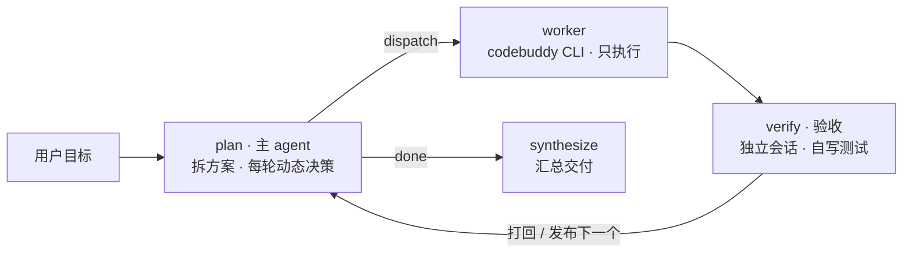

# Lodestar — LangGraph 三角色协作：主 agent（动态 plan）+ worker + 验收 agent

主 agent 是唯一在循环里的思考节点 `plan`：先拆「任务方案」，之后每轮读完产出和验收结果，动态修订方案再发布下一轮目标。worker 用本机 `codebuddy` 无头模式动手；验收 agent 是另一个独立 CLI 会话，自己写 test 脚本并执行来判定达标。



方案不是写死的 —— plan 每轮拿到「目标 + 已完成记录 + 当前验收结果 + 剩余方案」，可以补任务、改验收标准、删任务或安排补救。

## 快速开始

| 依赖 | 要求 | 用途 |
| --- | --- | --- |
| [uv](https://docs.astral.sh/uv/) | 最新版 | 环境、依赖、跑命令 |
| Python | 3.10+ | 后端（本机没有时 uv 自动下载） |
| [codebuddy CLI](https://www.codebuddy.cn/docs/cli/installation) | 最新版，需登录 | worker / 验收的执行入口 |
| DeepSeek API Key | — | 主 agent，也可用 `DEEPSEEK_API_KEY` |
| [Node.js](https://nodejs.org/) | 20+ | 仅装 CLI 或重建前端时需要 |

```bash
# 1. 装 uv（macOS / Linux）
curl -LsSf https://astral.sh/uv/install.sh | sh
# Windows: powershell -ExecutionPolicy ByPass -c "irm https://astral.sh/uv/install.ps1 | iex"

# 2. 拉代码装依赖
git clone git@github.com:Crazyboy233/lodestar-agent.git && cd lodestar-agent
uv sync

# 3. 配 key：在 config.yaml 同目录建 config.local.yaml（已 gitignore）
#    main_agent:
#      api_key: "sk-你的key"
#    或 export DEEPSEEK_API_KEY="sk-你的key"

# 4. 装并登录 CLI
npm install -g @tencent-ai/codebuddy-code
codebuddy            # 输入 /login，登录后退出

# 5. 起控制台
uv run python -m lodestar_agent --web
```

打开终端打印的地址（默认 `http://127.0.0.1:8788/`，端口占用会自动换）。`codebuddy` 不在 PATH 时，改 `config.yaml` 的 `worker.cli` / `verifier.cli` 为绝对路径，或把目录加进 PATH。

默认 `main_agent.model` 是 `deepseek-flash`；供应商没有这个型号时，按它的 OpenAI 兼容接口改 `main_agent.base_url` / `main_agent.model`（官方线路常用 `deepseek-chat`）。

**可选步骤**

```bash
# 命令行跑一次（默认产出目录 workspace/，页面上可改）
uv run python -m lodestar_agent "在 workspace/fib 里写 fib.py，打印前 10 个斐波那契数（每行一个），确认第一行是 1"

# 只验证 worker 链路，不花 token
uv run python -m lodestar_agent --dry-run "在 workspace 里创建 hello.py"

# 离线自检：图结构、打回重试、轮次上限、拆解重试、checkpoint 续跑，不依赖模型和登录态
uv run python tests/offline_check.py

# 重建前端（改了 frontend/ 才需要；static/ 已提交，正常使用可跳过）
cd frontend && npm ci && npm run build && cd ..
```

`tests/offline_check.py` 在 Windows 上会跳过少数依赖 `/bin/sh` 的进程组用例，进程树回收由 `windows_tree_kill` 用例覆盖。前端构建产物写回 `lodestar_agent/static/`，刷新浏览器即可，不用重启 Python。

### checkpoint 与续跑

每次运行的 state 落在 `checkpoints.sqlite`（已 gitignore），一次运行对应一个 `thread_id`：

```bash
uv run python -m lodestar_agent --thread-id fix-fib "在 workspace/fib 里写 fib.py …"
uv run python -m lodestar_agent --thread-id fix-fib --resume   # 中断/失败后从断点继续
```

- 只重跑「上次没走完的节点」，已定稿的任务不重做；worker 跑完只差验收的直接补验收。
- 执行失败终止的线程，`--resume` 会把该任务重试计数归零，否则一进 plan 就又撞上限。
- 同一 `thread_id` 不加 `--resume` 会报冲突，避免新 state 脏覆盖旧 checkpoint。

## 控制台

`--web` 只起页面、不带任务也支持；`--web "任务…"` 则起服务并立即开跑。左侧导航三块：

- **新任务**：回到任务输入框，同一进程可连续跑多个任务。
- **设置**：弹窗改配置（见「在页面里改配置」）。
- **任务历史**：按产出目录分组（一个目录 = 一个项目），点开可见任务清单与最终答复，可「继续这个会话」（可顺手写引导、单独换 worker / 验收模型）或「在此目录新建任务」。

输入卡上可指定**产出目录**（点路径弹系统文件夹选择器，不选则用 `worker.workdir`），worker / 验收各选一个模型（默认「CLI 决定」，会记住）。开跑后底部输入卡切成「引导」，可选投给**主 agent** 还是 **worker**；右侧「任务」面板列出每条拆解及其状态、轮次、耗时。

事件流每行四列：时间 · 节点（PLAN / WORK / VERIFY / FINAL）· 内容类别 · 正文。类别与节点正交：`派发` 是模型真正收到的 prompt，`任务` 是摘出来的人读版任务与验收标准，`输出` 是节点产出，`旁白` 是流程说明，`引导` 是投递进来的指令。超过 10 行会截断并给「展开全文」。

一次只跑一个：运行中「新任务」禁用，输入只发引导。每次开新任务会 `reset` 控制面（停止标志、引导信箱、事件流清空）。

「引导与退出」的边界语义：

| 操作 | 后台 | 生效时机 |
| --- | --- | --- |
| 开始任务 | 新线程跑一次 `run_session` | 立即（控制面先 reset） |
| 发引导 | 入队到对应信箱 | 下一次决策 / 下一次 worker 调用拼进 prompt，**投一次生效一次**，不打断当前轮 |
| 续跑前写引导 | 随 `run` 送 `seed_notes`，`reset()` 后立刻补投 | 续跑第一个节点边界 |
| 续跑换模型 | `worker_model` / `verifier_model` 随 `run` 传；不传 = 沿用配置，空串 = CLI 默认 | 本次运行立即生效 |
| 边界退出 | 置停止标志 + 等待上限 | **当前这轮模型回复跑完再收工**（退出码 130），超 `ui.drain_timeout_seconds` 才强杀 |

边界退出不是「中断」：跑完的 worker 不再进验收、跑完的验收不再进规划，做出的是完整产出而非半成品。**停掉模型和停掉脚本是两件事**，这里做前者 —— CLI 子进程按进程树回收（POSIX 进程组 SIGTERM→SIGKILL，Windows `taskkill /T /F`），HTTP 连接才会断，不再烧 token；主 agent 走流式调用，到点直接关生成器。退出后按真实完成度记 `[PASS]` / `[FAIL]` / `[SKIP] 已执行，未验收`。

为什么不直接给跑着的 worker 发消息：`codebuddy -p` 是次性子进程，stdin 已关闭，执行期间没有注入通道，所以做成「排队 + 节点边界消费」。

### 在页面里改配置

「设置」弹窗分「主模型 / 执行端 / 验收端 / 控制台」四组，`config.yaml` 里除 `ui.host / port / web` 外都能改：

| 分组 | 可改 |
| --- | --- |
| 主 agent | `base_url`、`api_key`、`model`、`temperature`、`max_retries`、`plan_retries` |
| worker | `cli`、`model`、`workdir`、`allowed_tools`、`timeout_seconds`、`max_turns`、`max_retries`、`add_dirs`、`env` |
| 验收 | `cli`、`model`、`allowed_tools`、`scratch_dir`、`timeout_seconds`、`max_rounds`、`max_retries`、`env` |
| 控制台 | `drain_timeout_seconds`、`models` |

写入 `config.local.yaml`（覆盖层，不动 `config.yaml`）；api_key 只回显掩码，留空 = 不修改；**下次开始任务生效**，运行中保存返回 409；字段有范围校验，任一不合法整次失败，不做「一半生效」。

## 三个角色

| 角色 | 跑在哪 | 职责 | 权限 |
| --- | --- | --- | --- |
| 主 agent | DeepSeek API（你的 key） | 拆任务、写验收标准、每轮读进度并动态决策、汇总 | 不碰文件，只调模型 |
| worker | codebuddy CLI 会话 A | 只执行，不判断自己是否完成 | `Read,Write,Edit,Bash` |
| 验收 | codebuddy CLI 会话 B（可换模型） | 自己写 test 脚本并执行，给结论和修改意见 | `Read,Write,Bash`（被测目录只读，脚本写到 `.verify/`） |

三条不能破的约定：

- **「完成」由验收方判定**，不采信 worker 自述。
- **主 agent 每轮都知道进展**：拿到目标、已完成记录、当前验收结果、剩余方案后再决策。
- **验收标准必须可执行**：带「浏览器 / 控制台报错 / 响应式 / 美观」这类词的会被丢掉，交回验收 agent 自行设计静态检查。

验收建议选一个和 worker 不同的模型 —— 否则两边判定是同一个模型在自说自话。

## 闸门（防死循环 / 防跑飞）

| 闸门 | 配置 | 命中后 |
| --- | --- | --- |
| 单条子任务往复次数 | `verifier.max_rounds`（默认 3） | 判失败，记入汇总，继续下一条 |
| 单次 CLI 内部轮数 | `worker.max_turns`（默认 0 = 不传，CLI 非交互默认 500） | CLI 自己停下并报 `Max turns exceeded` |
| 单次调用墙钟 | `worker/verifier.timeout_seconds`（worker 默认 600） | 终止整棵进程树；已产出内容保留并交验收，重试用 `--resume` 接同一会话 |
| 图节点总步数 | `recursion_limit=120` | 兜底防图打转 |
| 主 agent 请求失败 | `main_agent.max_retries`（默认 3） | 重试耗尽 → 终止，报失败节点+原因 |
| 拆解解析失败 | `main_agent.plan_retries`（默认 2） | 带纠正提示重试，用尽退化为单任务 |
| worker / 验收失败 | `worker.max_retries`、`verifier.max_retries`（各默认 2） | 重试耗尽 → 终止，报失败节点+原因 |

## 配置说明（config.yaml）

| 字段 | 说明 |
| --- | --- |
| `main_agent.base_url` / `api_key` / `model` | 主 agent 模型（OpenAI 兼容）。key 建议放 `config.local.yaml`，留空读 `DEEPSEEK_API_KEY` |
| `main_agent.max_retries` / `plan_retries` | 请求重试次数；拆解解析失败重试次数（用尽退化为单任务） |
| `worker.cli` / `verifier.cli` | `codebuddy` 或绝对路径，默认同一个 |
| `worker.model` / `verifier.model` | 留空 = CLI 默认；验收填别的型号才算真·第三方判定 |
| `worker.workdir` | 默认产出目录 / 两个 agent 的 cwd，每次任务可在页面另选 |
| `worker.allowed_tools` / `verifier.allowed_tools` | 前者 `Read,Write,Edit,Bash`；后者 `Read,Write,Bash`（写 test 脚本需要 Write） |
| `verifier.scratch_dir` | 测试脚本目录（相对 `workdir`），默认 `.verify` |
| `worker.max_turns` | 透传 `--max-turns`；**0 = 不传**，用 CLI 默认。填 15 这种小值只会把正常任务掐断 |
| `verifier.max_rounds` | 同一条子任务最多「执行 → 验收」几轮 |
| `worker.max_retries` / `verifier.max_retries` | 各自请求失败重试次数，超限终止流程 |
| `worker.add_dirs` | 额外授权目录（默认只能动 workdir） |
| `worker.env` / `verifier.env` | 额外环境变量，如 `CODEBUDDY_AUTH_TOKEN` |
| `ui.web` | true = 不写 `--web` 也默认开控制台 |
| `ui.host` / `ui.port` | 控制台监听地址与端口（默认 127.0.0.1:8788，占用回退随机端口） |
| `ui.drain_timeout_seconds` | 边界退出后最多再等多久（默认 120s） |
| `ui.models` | 页面下拉候选；不写用内置列表（取自 `codebuddy --help`） |

## 文件结构

| 文件 | 作用 |
| --- | --- |
| `config.yaml` | 唯一配置入口：主模型 / worker / 验收 / 控制台 |
| `lodestar_agent/config.py` | 读配置，支持 `config.local.yaml` 覆盖与环境变量兜底 |
| `lodestar_agent/graph.py` | 状态机：`plan(动态) → worker → verify → 循环回 plan → synthesize` |
| `lodestar_agent/session.py` | 执行体：`Console`（终端+页面双写）、`run_session`、`Runner`（线程包装） |
| `lodestar_agent/worker.py` | CLI 调用层：`run_cli` / `run_worker` / `run_verifier`（可取消、可注入引导） |
| `lodestar_agent/control.py` | 控制面：引导信箱、停止标志、事件总线（SSE 源） |
| `lodestar_agent/history.py` | 运行历史：`history.json` 读写、按产出目录分组、旧 checkpoint 回填 |
| `lodestar_agent/fspick.py` | 系统文件夹选择器：osascript / PowerShell / zenity / kdialog |
| `lodestar_agent/server.py` | FastAPI + uvicorn：JSON 接口、SSE、静态托管（不含页面内容） |
| `lodestar_agent/__main__.py` | 命令行入口：逐节点打印、写日志、管 checkpoint、起控制台 |
| `frontend/src/` | React + TS 源码。状态集中在 `hooks/`（`useUiMode` 管屏幕与输入区形态、`useRunSession` 管运行态与 SSE、`useHistory` 管历史），`App.tsx` 只做接线 |
| `lodestar_agent/static/` | 前端构建产物（Vite 输出，勿手改） |
| `history.json` | 运行历史（gitignore），按产出目录分组，最多 300 条 |
| `workspace/` | 默认产出目录（gitignore） |
| `checkpoints.sqlite` | 每次运行的 state 快照（gitignore），`--resume` 的数据源 |
| `tests/offline_check.py` | 离线自检 |

## 已知限制

- 子任务**串行**执行；要并行就把 worker 节点改成 `Send` 分发。后一条只能依赖磁盘产出，没有显式上下文传递。
- `-y` 等于全放行；要收紧就删 `Bash` 或缩 `allowed_tools`。
- 验收 agent 的 Bash/Write 理论上仍能碰被测目录，靠「被测目录只读」的约定；要硬隔离就改成副本模式。
- 收尾由「剩余任务为空」决定，不是「全部通过」—— 模型若忘了安排补救，失败项会直接进汇总。
- **引导不能改已在跑的那一轮**：想立刻改只能边界退出再 `--resume`。
- 控制台只监听本机且无鉴权；要暴露到局域网自己加反向代理和访问控制。
- 历史无删除 / 重命名；删掉 `history.json` 后旧记录会从 checkpoint 回填，但目录归组只能落到默认产出目录。
- 文件夹选择器弹在后端所在机器上；远程访问时会弹在服务器桌面，无图形界面则接口报错（不静默失败）。
