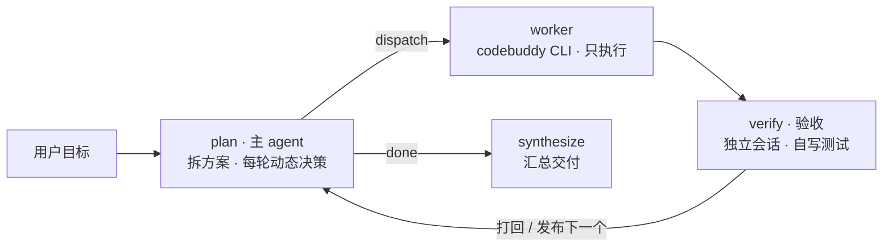

# Lodestar — LangGraph 三角色协作：主 agent（动态 plan）+ worker + 验收 agent

主 agent 是唯一在循环里的思考节点 `plan`：先拆「任务方案」，之后每一轮读完产出和验收结果，动态修订方案再发布下一轮目标。worker 用本机 `codebuddy` 的无头模式动手；验收 agent 是另一个独立的 CLI 会话，自己写 test 脚本并执行来判定达标。



plan 是唯一在循环里的节点：verify 的结果回到 plan，由它决定打回重做还是发布下一个。「任务方案」也不是写死的 —— plan 每轮拿到「目标 + 已完成记录 + 当前验收结果 + 剩余方案」，可以补充新任务、修改验收标准、删掉已不需要的任务，或安排补救。

## 快速开始

### 前置条件

| 依赖 | 要求 | 用途 |
| --- | --- | --- |
| [uv](https://docs.astral.sh/uv/) | 最新版 | 创建 Python 环境、装依赖、跑命令 |
| Python | 3.10+ | 后端；本机没有时 uv 会自动下载 |
| [codebuddy CLI](https://www.codebuddy.cn/docs/cli/installation) | 最新版 | worker / 验收 agent 的执行入口，需要能登录 |
| DeepSeek API Key | — | 主 agent；也可用环境变量 `DEEPSEEK_API_KEY` |
| [Node.js](https://nodejs.org/) | 20 LTS 或更高 | 用 npm 安装 codebuddy CLI、或重建前端时需要；两者都不做可跳过 |

> 不跑前端开发、且 codebuddy CLI 已经用独立安装包装好时，**不需要装 Node**；`lodestar_agent/static/` 里的产物已经可以直接用。

### 新电脑最短跑通流程（macOS / Windows）

#### 1. 安装 uv

macOS / Linux：

```bash
curl -LsSf https://astral.sh/uv/install.sh | sh
```

Windows PowerShell：

```powershell
powershell -ExecutionPolicy ByPass -c "irm https://astral.sh/uv/install.ps1 | iex"
```

装完重开一个终端，确认：

```bash
uv --version
```

#### 2. 拉代码并装 Python 依赖

```bash
# 把 URL 换成你的仓库地址
git clone https://github.com/your-org/lodestar.git lodestar_test
cd lodestar_test
uv sync
```

如果本机没有 3.10+，uv 会自动下载；也可以先执行 `uv python install 3.12`。

#### 3. 配置主 agent 的 API Key

在 `config.yaml` 同目录新建 `config.local.yaml`（该文件已 gitignore，不会进版本库）：

```yaml
main_agent:
  api_key: "sk-你的key"
```

或者用环境变量（任选一种）：

macOS / Linux：

```bash
export DEEPSEEK_API_KEY="sk-你的key"
```

Windows PowerShell：

```powershell
$env:DEEPSEEK_API_KEY = "sk-你的key"
```

> 默认 `main_agent.model` 是 `deepseek-flash`。如果你的供应商没有这个型号，按它提供的 OpenAI 兼容接口改 `config.yaml` 里的 `main_agent.base_url` / `main_agent.model`（例如官方线路常用 `deepseek-chat`）。

#### 4. 安装并登录 codebuddy CLI

常见安装方式（以 [codebuddy CLI 安装文档](https://www.codebuddy.cn/docs/cli/installation) 为准）：

```bash
npm install -g @tencent-ai/codebuddy-code
```

装完确认它在 PATH 里：

macOS：

```bash
which codebuddy
codebuddy        # 进入交互界面后输入 /login，登录完退出
```

Windows PowerShell：

```powershell
where.exe codebuddy
codebuddy        # 进入交互界面后输入 /login，登录完退出
```

如果 `codebuddy` 不在 PATH，有两个办法：把 `config.yaml` 的 `worker.cli` / `verifier.cli` 改成绝对路径；或把 CLI 所在目录加进 PATH。

#### 5. 起控制台

```bash
uv run python -m lodestar_agent --web
```

打开终端打印的地址（默认 `http://127.0.0.1:8788/`）。端口被占用时会自动换一个端口，以终端输出为准。

#### 6. 可选：重新构建前端

仓库里已经提交了 `lodestar_agent/static/` 构建产物，**正常使用不用跑这一步**。只有改了 `frontend/` 才需要：

```bash
cd frontend
npm ci
npm run build
cd ..
```

`npm ci` 需要 Node 20+。构建产物会写回 `lodestar_agent/static/`，刷新浏览器即可，不用重启 Python。

#### 7. 可选：离线自检

不需要 API Key，也不需要 codebuddy 登录态。Windows 上少数依赖 `/bin/sh` 的进程组用例会自动跳过，Windows 的进程树回收由 `windows_tree_kill` 用例覆盖：

```bash
uv run python tests/offline_check.py
```

默认产出目录是项目下的 `workspace/`；在页面上点一下「产出目录」就能改（macOS / Windows 都会弹系统文件夹选择器）。也可以命令行直接跑一次：

```bash
uv run python -m lodestar_agent "在 workspace/fib 里写 fib.py，打印前 10 个斐波那契数（每行一个），确认第一行是 1"
```

### 新电脑常见问题

- **`uv: command not found`**：安装后重开一个终端；Windows 还需要确认 `%USERPROFILE%\.local\bin` 或 uv 提示的目录在 PATH 里。
- **`codebuddy: command not found`**：用 `where.exe codebuddy`（Windows）/ `which codebuddy`（macOS）确认路径；找不到就把 `config.yaml` 的 `worker.cli` / `verifier.cli` 改成可执行文件的绝对路径（Windows 注意 `.cmd` 后缀）。
- **`codebuddy` 提示未登录**：在终端运行 `codebuddy`，输入 `/login` 完成登录；它和 IDE 里的登录态不共享。
- **Windows PowerShell 报 `codebuddy.ps1 cannot be loaded`**：执行 `Set-ExecutionPolicy -Scope CurrentUser RemoteSigned`（或直接运行 `codebuddy.cmd`）。
- **`npm` / `node` 找不到**：如果 codebuddy CLI 已经用独立安装包装好、也不改前端，可以跳过；否则装 Node 20+（npm 安装 codebuddy 或重建前端都要它）。
- **页面打不开 / 端口被占用**：控制台默认 8788，被占用会自动换端口，以终端打印的 URL 为准；别直接用 `config.yaml` 里写死的端口猜。
- **`config.local.yaml` 不生效**：它必须和 `config.yaml` 在同一个目录；`main_agent:` 下面缩进两个空格，`api_key` 放这一层。
- **Windows 上点「产出目录」没反应**：后端会调用系统 `powershell.exe` 弹 FolderBrowserDialog；如果报错会显示在输入卡下方，通常是没有图形界面会话或 PowerShell 被策略禁用。
- **macOS 第一次弹目录选择器**：如果系统弹出权限提示，允许当前终端/Python 进程访问文件；拒绝后可以到「系统设置 → 隐私与安全性」里重新打开。

实测输出（真实跑过的一次，含一次打回）：

```
[主 agent] 拆解任务方案
  1. 创建 workspace/fib/fib.py …   验收: python3 workspace/fib/fib.py | head -1 == 1
  2. 运行并核对首行 …
[worker] 执行  第 1 条 · 第 1 轮      6.6s  → 已创建
[verifier] 验收 → PASS
[主 agent] 动态规划 → 继续下一个（完成 1 条 / 失败 0）
[worker] 执行  第 2 条 · 第 1 轮      18.5s  → 输出首行是 0，不符合要求
[verifier] 验收 → FAIL
[主 agent] 动态规划 → 继续下一个（完成 1 条 / 失败 0）  ← 打回重做
[worker] 执行  第 2 条 · 第 2 轮      19.4s  → a,b = 0,1 改成 1,1
[verifier] 验收 → PASS
[主 agent] 动态规划 → 收尾（完成 2 条 / 失败 0）
[主 agent] 最终答复               两个子任务均通过，产物 workspace/fib/fib.py
```

### 降级路径

```bash
# 只验证 worker 链路（跳过主模型和验收，不花 token）
uv run python -m lodestar_agent --dry-run "在 workspace 里创建 hello.py"

# 纯离线自检：图结构、打回重试、轮次上限、拆解重试、checkpoint 续跑，都不依赖模型和登录态
uv run python tests/offline_check.py
```

### checkpoint 与续跑

每次运行的 state 落在 `checkpoints.sqlite`（已 gitignore），一次运行对应一个 `thread_id`：

```bash
# 指定 thread id；不给则按时间戳自动生成，日志头部会打印
uv run python -m lodestar_agent --thread-id fix-fib "在 workspace/fib 里写 fib.py …"

# 中断（Ctrl+C）或执行失败终止后，从断点继续
uv run python -m lodestar_agent --thread-id fix-fib --resume
```

- 续跑只重跑「上次没走完的节点」，已定稿的任务不会重做。
- **执行失败终止**的线程，`--resume` 会自动把该任务的重试计数归零 —— 否则一进 plan 就又撞上限，等于续不动。
- 同一 `thread_id` 不加 `--resume` 会直接报冲突，避免新 state 脏覆盖旧 checkpoint。

### 页面驱动：启动只起页面

```bash
uv run python -m lodestar_agent --web      # 不带任务
```

打开 `http://127.0.0.1:8788/`，布局按主流 agent 控制台来：左侧是固定导航栏，右侧是当前会话。

左侧导航只有三块：

- **新任务**：回到任务输入框；同一个进程可以连续跑多个任务，不用重启
- **设置**：弹窗里改配置（见下文），按「主模型 / 执行端 / 验收端 / 控制台」分组
- **任务历史**：按产出目录分组 —— 一个目录就是一个项目，项目下是这个目录跑过的所有会话（同一目录下的多个任务 = 多条会话）。点开可看任务清单、最终答复，并可「继续这个会话」或「在此目录新建任务」

首屏是新任务页：**上方是执行过程区，底部是一块独立的圆角输入卡**（和现代 agent 一样）。空闲时上方只显示欢迎语，开始后在同一块区域打印执行过程：

- 填目标 → 开始（或 ⌘ / Ctrl + Enter）
- **产出目录可以单独指定**：点一下路径会弹出**系统文件夹选择器**（macOS / Windows，Linux 走 zenity / kdialog），选完直接回填，不需要手输路径。不选就用配置里的 `worker.workdir`；开始后本次运行的 cwd 与产出都落在这个目录，左侧历史也按它归类
- **worker / 验收各选一个模型**（默认「CLI 决定」；选过的会记住）
- thread 留空自动生成；要接着上次跑，就填 thread 并勾「续跑」
- 跑起来之后上方开始打印执行过程，终端只是镜像；底部输入卡切成「给主 agent 的引导」，右侧「任务」面板列出拆解出的每一条及其状态（待执行 / 执行中 / 通过 / 未通过 / 未验收）和轮次、耗时
- 跑完后底部恢复为新任务输入框，上方保留刚才的执行过程；点「新任务」回到空白欢迎页

历史落在项目根目录的 `history.json`（已 gitignore）：每次开始写一条，结束时补上退出码 / 耗时 / 最终答复。升级前的旧记录没有这个文件，左侧会自动从 `checkpoints.sqlite` 回填一次，不会一片空白；进程被强杀时残留的「运行中」会显示为「已退出」。历史里点开一个会话时，顶栏、任务清单、最终答复都跟着它走，不会还挂着「新任务」。

模型下拉的候选来自 `codebuddy --help` 的 `--model` 说明（`deepseek-v4.1-flash`、`deepseek-v4-pro`、`glm-5.3`、`kimi-k3.1-pro` 等），可以在 `config.yaml` 的 `ui.models` 里覆盖。验收建议选一个和 worker 不同的模型 —— 否则两边的判定是同一个模型在自说自话。

一次只跑一个：运行中「新任务」按钮会禁用，底部输入只发引导、不会开新任务；要开新任务先等它结束或点边界退出。每次开始新任务会 `reset` 一次控制面 —— 停止标志、引导信箱、事件流全部清空，页面收到 `reset` 后同步清屏。

`--web` 后面带任务也支持（起服务并立即开始），方便脚本化。

### 前端开发

界面是 React + TypeScript，Vite 构建，产物落在 `lodestar_agent/static/`。后端是 FastAPI + uvicorn（`lodestar_agent/server.py`），只做 JSON 接口、SSE 事件流和静态托管，不拼任何页面内容。

```bash
cd frontend
npm ci             # 首次，按 package-lock.json 安装
npm run dev        # 5174，/state /config /command /events /history 代理到 8788 的 Python 进程
npm run build      # 产物写回 lodestar_agent/static/
```

改了前端要 `npm run build`，然后刷新浏览器即可（不用重启 Python 进程）。类型检查单独跑 `npx tsc --noEmit`。

### 页面里改配置

左侧导航栏点「设置」打开弹窗（不是抽屉），`config.yaml` 里除了 `ui.host / port / web` 之外的字段都能改。窗口按「主模型 / 执行端 / 验收端 / 控制台」四个标签页分组，字段名全部用中文，原始 key 作为副标题：

| 分组 | 可改 |
| --- | --- |
| 主 agent | `base_url`、`api_key`、`model`、`temperature`、`max_retries`、`plan_retries` |
| worker | `cli`、`model`、`workdir`、`allowed_tools`、`timeout_seconds`、`max_turns`、`max_retries`、`add_dirs`、`env` |
| 验收 | `cli`、`model`、`allowed_tools`、`scratch_dir`、`timeout_seconds`、`max_rounds`、`max_retries`、`env` |
| 控制台 | `drain_timeout_seconds`、`models` |

几条约定：

- **写到 `config.local.yaml`**（覆盖层，已在 `.gitignore` 里），不动 `config.yaml`。
- **api_key 只回显掩码**（`sk-a…f8c2`），输入框留空 = 不修改；填了新值才覆盖。掩码永远不会被写回文件。
- **下次开始任务生效**。任务运行中保存会被拒（409）—— 跑到一半换模型、换 workdir，出问题极难复现。
- 未知字段直接丢弃，数值有范围校验（`temperature` 0~2、`max_rounds` 1~20 等）。任何一项不合法整次保存失败，不做「一半生效」。
- 保存后左上角「任务历史」的目录分组、首页「默认产出目录」会一起刷新；`ui.host / ui.port` 要重启进程才生效，所以没放进面板。
- 「默认产出目录」同样点「选择…」弹系统文件夹选择器，不用手抄路径。

### 引导与边界退出

```bash
uv run python -m lodestar_agent --web "复杂任务…"
# 控制台  http://127.0.0.1:8788/    （端口被占用会自动回退到随机端口）
```

页面上的运行控制只有这三种，都不碰图内部结构，也不往正在执行的子进程里硬塞东西（配置和目录选择是独立接口）：

| 操作 | 后台做了什么 | 生效时机 |
| --- | --- | --- |
| 开始任务 | 新线程跑一次 `run_session` | 立即（控制面先 reset，上一轮状态清空） |
| 发引导（给主 agent / worker） | 入队到对应信箱 | 主 agent 在下一次决策、worker 在下一次被调用时拼进 prompt；**投一次生效一次**，不打断当前这一轮 |
| 边界退出 | 置停止标志 + 记一个等待上限 | **当前这次模型回复跑完再收工**：跑完的 worker 不再进验收，跑完的验收不再进下一轮规划，`plan` 里也不再派新任务；只有超过 `ui.drain_timeout_seconds` 还没结束才强杀，退出码 130 |

顶部还有一条**工作栏**，随时能看出现在是谁在干活：`worker 节点 · codebuddy · deepseek-v4.1-flash · 第 2 条 · 第 1/3 轮 · 改 style.css 的媒体查询 · 18s`。主 agent 调模型时同样会显示（`主 agent · deepseek-flash`），不用猜当前是规划、执行还是验收。

「边界退出」不是「中断」。点退出时你可以看到它现在卡在哪个节点、用的哪个模型（`worker 节点 · codebuddy · deepseek-v4.1-flash`），页面会一直显示已等多少秒，直到这一轮自然结束。这样当前节点的产出是完整的，不会留半成品。

**「停掉模型」和「停掉脚本」是两件事**，这里做的是前者：

- worker / verifier 是 CLI 子进程，强杀时要收掉整棵进程树：macOS / Linux 对**进程组**发 SIGTERM → SIGKILL；Windows 用 `taskkill /PID <pid> /T /F`。连它拉起的 node 子进程一起收掉，它持有的 HTTP 连接才会断开，服务端才会停止生成，不会继续烧 token。
- 主 agent 走流式调用，到点直接关闭生成器，底层连接断开。非流式请求做不到这一点：一旦发出，服务端会把整段生成完才返回，本地再怎么放弃也已经烧掉了。
- 进程退出时 `atexit` 再兜一次，回收所有还活着的 CLI 进程（Windows 为进程树）。

退出后这条任务会按真实完成度记一笔，三态区分：

- 验过且通过 → `[PASS]`
- 验过没过 → `[FAIL]`
- 只跑了 worker、没来得及验收 → `[SKIP] 已执行，未验收`（不算失败，免得冤枉一条其实干完的活）

`--resume` 按中断点接着做，**不会白扔已经跑完的东西**：
worker 跑完只差验收的，直接补验收不重跑；worker 还没开始的，重跑那一条；已验证完的，直接派下一个。

为什么不直接给正在跑的 worker 发消息：worker 是 `codebuddy -p` 的一次性子进程，stdin 已关闭，执行期间没有注入通道。所以做成「排队 + 在下一个节点边界消费」——体感上是不打断，语义上也说清楚。

## 三个角色

| 角色 | 跑在哪 | 职责 | 权限 |
| --- | --- | --- | --- |
| 主 agent | DeepSeek API（你的 key） | 拆任务、写验收标准、**每轮读进度并动态决策/改计划**、汇总 | 不碰文件，只调模型 |
| worker | codebuddy CLI 会话 A | 只执行，不判断自己是否完成 | `Read,Write,Edit,Bash` |
| 验收 | codebuddy CLI 会话 B（可换模型） | 自己写 test 脚本并执行，给结论和修改意见 | `Read,Write,Bash`（被测目录只读，脚本写到 `.verify/`） |

三条不能破的约定：

- **「完成」由验收方判定**，不采信 worker 自述 —— worker 说"我做完了"不算数。
- **主 agent 每轮都知道进展**：拿到目标、已完成记录、当前验收结果、剩余方案后再决策，不是到最后汇总才第一次看到结果。
- **验收标准必须可执行**：带"浏览器 / 控制台报错 / 响应式 / 美观"这类词的验收标准会被直接丢掉，交回验收 agent 自行设计静态检查。

## 闸门（防死循环 / 防跑飞）

| 闸门 | 配置 | 命中后 |
| --- | --- | --- |
| 单条子任务的往复次数 | `verifier.max_rounds`（默认 3） | 判失败，记入汇总，继续下一条 |
| 单次 CLI 内部轮数 | `worker.max_turns`（默认 15，透传 `--max-turns`） | CLI 自行收敛，避免一条任务跑几十轮 |
| 单次调用墙钟 | `worker/verifier.timeout_seconds` | 终止**整棵子进程树**（POSIX 进程组 SIGTERM→SIGKILL；Windows `taskkill /T /F`） |
| 图节点总步数 | `recursion_limit=120` | 兜底防图本身打转 |
| 主 agent 模型请求失败 | `main_agent.max_retries`（默认 3） | 重试耗尽 → 终止流程，报失败节点+原因 |
| 拆解输出解析失败 | `main_agent.plan_retries`（默认 2） | 带纠正提示重试；用尽则退化为单任务 |
| worker 执行失败 | `worker.max_retries`（默认 2） | 重试耗尽 → 终止流程，报失败节点+原因 |
| 验收 agent 请求失败 | `verifier.max_retries`（默认 2） | 重试耗尽 → 终止流程，报失败节点+原因 |

## 配置说明（config.yaml）

| 字段 | 说明 |
| --- | --- |
| `main_agent.base_url` / `api_key` / `model` | 主 agent 模型（OpenAI 兼容）。key 建议放 `config.local.yaml`，留空读 `DEEPSEEK_API_KEY` |
| `main_agent.max_retries` | 主 agent 模型请求失败重试次数，超限终止流程 |
| `main_agent.plan_retries` | 拆解输出解析不成 JSON 的重试次数（与请求重试分开计），用尽退化为单任务 |
| `worker.cli` / `verifier.cli` | `codebuddy` 或绝对路径，默认同一个 |
| `worker.model` / `verifier.model` | 留空 = CLI 默认；`verifier.model` 填别的型号才算真·第三方判定 |
| `worker.workdir` | 默认产出目录 / 两个 agent 的 cwd；每次任务可在页面另选 |
| `worker.allowed_tools` / `verifier.allowed_tools` | 前者 `Read,Write,Edit,Bash`；后者 `Read,Write,Bash`（写 test 脚本需要 Write） |
| `verifier.scratch_dir` | 测试脚本目录（相对 `workdir`），默认 `.verify` |
| `worker.max_turns` | 单次执行最多轮数，透传 `--max-turns` |
| `verifier.max_rounds` | 同一条子任务最多「执行 → 验收」几轮 |
| `worker.max_retries` / `verifier.max_retries` | 各自请求失败重试次数，超限终止流程 |
| `worker.add_dirs` | 额外授权目录（默认只能动 workdir） |
| `worker.env` / `verifier.env` | 额外环境变量，如 `CODEBUDDY_AUTH_TOKEN` |
| `ui.web` | true = 不写 `--web` 也默认开控制台 |
| `ui.host` / `ui.port` | 控制台监听地址与端口（默认 127.0.0.1:8788，占用时回退随机端口） |
| `ui.drain_timeout_seconds` | 点边界退出后最多再等多久（默认 120s），等的是「当前这次模型回复跑完」，超时才强制终止 |
| `ui.models` | 页面上 worker / 验收下拉的候选模型；不写就用内置列表（取自 `codebuddy --help`） |

## 文件结构

| 文件 | 作用 |
| --- | --- |
| `config.yaml` | 唯一配置入口：主模型 / worker / 验收 / 控制台 |
| `lodestar_agent/config.py` | 读配置，支持 `config.local.yaml` 覆盖与环境变量兜底 |
| `lodestar_agent/graph.py` | 状态机：`plan(动态) → worker → verify → 循环回 plan → synthesize` |
| `lodestar_agent/session.py` | 执行体：`Console`（终端+页面双写）、`run_session`（跑一次）、`Runner`（线程包装，页面驱动） |
| `lodestar_agent/history.py` | 运行历史：`history.json` 读写、按产出目录分组、从旧 checkpoint 回填 |
| `lodestar_agent/fspick.py` | 系统文件夹选择器：macOS osascript / Windows PowerShell / Linux zenity / kdialog |
| `lodestar_agent/worker.py` | CLI 调用层：`run_cli` / `run_worker` / `run_verifier`（可取消、可注入引导） |
| `lodestar_agent/control.py` | 控制面：引导信箱、停止标志、事件总线（SSE 的源） |
| `lodestar_agent/server.py` | FastAPI + uvicorn：JSON 接口、SSE 事件流、静态托管（不含任何页面内容） |
| `frontend/` | React + TypeScript 源码：`src/components/` 拆成 Sidebar / Header / Workbar / LaunchPanel / Stream / TaskPanel / GuidePanel / QuitPanel / ConfigDialog / HistoryView |
| `lodestar_agent/static/` | 前端构建产物（Vite 输出，勿手改）；`index.html` 只留挂载点，页面由 React 渲染 |
| `history.json` | 左侧导航的运行历史（gitignore），按产出目录分组 |
| `lodestar_agent/__main__.py` | 命令行入口，逐节点打印、写日志、管 checkpoint、起控制台 |
| `workspace/` | 默认产出目录（gitignore）；每次任务可以在首页另选 |
| `checkpoints.sqlite` | 每次运行的 state 快照（gitignore），`--resume` 的数据源 |
| `tests/offline_check.py` | 离线自检 |

## 已知限制

- 子任务**串行**执行；要并行就把 worker 节点改成 `Send` 分发。
- 后一个子任务只能依赖磁盘产出，没有显式的上下文传递。
- `-y` 等于全放行，worker 会以当前产出目录为 cwd 直接动文件；要收紧就删 `Bash` 或缩 `allowed_tools`。
- 验收 agent 的 Bash/Write 理论上仍能碰被测目录，靠的是「被测目录只读」这一约定；要硬隔离就改成副本模式（把 `workspace/` 拷到临时目录再验收）。
- 收尾由「剩余任务为空」决定，不是「全部通过」——模型若忘了安排补救，失败项会直接进汇总。
- **引导不能改已在跑的那一轮**：它是排队注入，worker 正在跑时投的指令要等这一轮（或这条任务）结束才生效。想立刻改，只能边界退出再 `--resume`。
- **边界退出会等当前这一轮跑完**，长任务可能要等几十秒；这是有意为之（不产生半成品），嫌久就调小 `ui.drain_timeout_seconds`。
- 控制台只监听本机且没有鉴权；要暴露到局域网，自己加反向代理和访问控制，别直接把 `ui.host` 改成 `0.0.0.0` 就放出去。
- 历史只存在本机 `history.json`（最多 300 条），没有删除 / 重命名；删掉它之后旧记录会从 `checkpoints.sqlite` 回填，但目录归组只能落到默认产出目录。
- **文件夹选择器在后端所在的机器上弹出**：本机使用没问题；如果是远程访问控制台，弹窗会出现在服务器那台机器的桌面上。没有图形界面时接口会返回错误，不会静默失败。
